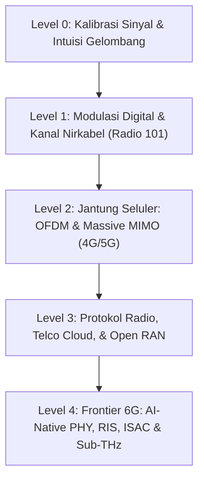

# 📡 SILABUS MASTER: DARI DASAR TELCO SAMPAI 6G SYSTEMS FELLOW
*Panduan Kurikulum Transisi Software Engineer (SWE) ke Arsitek Telekomunikasi 6G*

---

## 🎯 Gambaran Umum & Filosofi Kurikulum
Kurikulum ini dirancang khusus untuk menjembatani latar belakang **Teknik Elektro** dan keahlian **Software Engineering (SWE)** menuju ranah **6G Physical Layer & Telco Cloud Architecture**. Di era 5G-Advanced dan 6G, pemrosesan sinyal radio berpindah dari kotak perangkat keras tertutup (*black-box ASICs*) ke arsitektur perangkat lunak modular berbasis GPU (*AI-Native PHY*, Open RAN, dan *differentiable link-level simulators* seperti NVIDIA Sionna).

---

## 🗺️ Peta Jalur Pembelajaran (Learning Milestones)

---

## 🔹 LEVEL 0: Kalibrasi Gelombang & Intuisi Sinyal
> **Target:** Membangun insting fisik terhadap sinyal di udara tanpa terjebak penurunan rumus kalkulus yang kaku.

### 1. Waktu vs. Frekuensi (Domain Dualitas)
* **Analogi Jus Buah Fourier:** Sinyal waktu adalah jus campur; spektrum frekuensi adalah daftar resep takaran tiap buah.
* Transformasi Fourier (FT, DFT, FFT) sebagai alat "kacamata tembus pandang" untuk melihat kepadatan energi frekuensi.
* Kenapa spektrum frekuensi (Hz, MHz, GHz) menjadi komoditas paling mahal di dunia telekomunikasi.

### 2. Baseband vs. Passband (Fisika Antena)
* Kenapa suara manusia (20 Hz – 20 kHz) tidak bisa langsung dipancarkan lewat udara:
  $$\lambda = \frac{c}{f}$$
* Hubungan panjang gelombang ($\lambda$) dengan ukuran fisik antena dipole ($\lambda / 2$ atau $\lambda / 4$). Kenapa antena radio AM panjangnya puluhan meter, sedangkan antena 5G di smartphone cuma beberapa milimeter.
* Konsep Frekuensi Pembawa (*Carrier Frequency*) dan *Upconversion/Downconversion*.

### 3. Representasi I/Q & Bilangan Kompleks ($I + jQ$)
* Menghilangkan trauma bilangan imajiner: $j$ hanyalah penanda geometris rotasi 90° agar dua gelombang ortogonal ($\cos$ dan $\sin$) bisa berbagi kabel/antena yang sama tanpa saling meniadakan.
* Hubungan matematis:
  $$s(t) = I(t)\cos(2\pi f_c t) - Q(t)\sin(2\pi f_c t) = \text{Re}\left\{ (I(t) + jQ(t)) e^{j 2\pi f_c t} \right\}$$

### 4. Batas Absolut Alam Semesta: Kapasitas Shannon-Hartley
* Persamaan fundamental kapasitas kanal:
  $$C = B \log_2\left(1 + \frac{S}{N}\right)$$
* Trade-off abadi antara Lebar Pita (*Bandwidth* $B$) dan Daya Sinyal terhadap Derau (*SNR*).
* Desah Termal Johnson-Nyquist: Kenapa di suhu ruangan ($T = 290\text{ K}$) selalu ada desah bawaan semesta ($N_0 = k_B T \approx -174\text{ dBm/Hz}$).

---

## 🔹 LEVEL 1: Modulasi Digital, Kanal Nirkabel, & Evaluasi Kinerja
> **Target:** Memahami bagaimana bit biner dikemas ke gelombang dan bagaimana badai udara mendistorsi data tersebut.

### 1. Taksonomi Modulasi Digital
* Dari nada tunggal ke konstelasi multi-bit: ASK/FSK $\rightarrow$ BPSK (1 bit/simbol) $\rightarrow$ QPSK (2 bit/simbol).
* **M-QAM (16-QAM, 64-QAM, 256-QAM, 1024-QAM):**
  * Mental model papan catur koordinat senter $I/Q$.
  * Trade-off: Semakin banyak bit per simbol, efisiensi spektral melonjak, tetapi jarak antar titik konstelasi kian rapat dan rentan eror.
  * *Gray Coding:* Strategi penomoran biner agar kesalahan tebak titik terdekat hanya menyebabkan 1 bit eror.

### 2. Anatomi Kanal Nirkabel (The Hostile Air)
* **Path Loss & Shadowing:** Atenuasi daya sinyal seiring jarak ($d^{-\alpha}$) dan penghalang makro (bukit, gedung besar).
* **Multipath Fading:** Fenomena pantulan gelombang (*constructive vs destructive interference*) yang menciptakan lembah sinyal (*deep fade*).
* **Model Kanal Standar Industri (3GPP TR 38.901):**
  * *AWGN (Additive White Gaussian Noise):* Model dasar tanpa pantulan.
  * *Rayleigh vs Rician Fading:* Kondisi tanpa garis pandang (NLOS) vs dengan garis pandang langsung (LOS).
  * *CDL (Clustered Delay Line) & TDL (Tapped Delay Line):* Simulasi ray pantulan kluster realistis untuk evaluasi MIMO 5G/6G.
* **Doppler Effect & Coherence Time:** Pergeseran frekuensi saat perangkat bergerak kencang (analogi suara sirine ambulans).

### 3. Deteksi & Koreksi Eror (Channel Coding / FEC)
* Filosofi "Bubble Wrap" bit: Kenapa bit mentah wajib dibungkus bit proteksi (*parity*).
* Evolusi Coding: Parity $\rightarrow$ Hamming $\rightarrow$ Viterbi/Convolutional $\rightarrow$ Turbo Code (3G/4G) $\rightarrow$ **5G LDPC (Data) & Polar Codes (Control)**.
* **Log-Likelihood Ratio (LLR):** Konsep probabilitas kepastian (*soft decision*) vs vonis kaku (*hard decision*).

### 4. Hands-on Milestone: Benchmarking Kinerja Link
* Simulasi Monte Carlo: Menghitung kurva **BER (Bit Error Rate) vs. SNR ($E_b/N_0$)**.
* Menentukan *Waterfall Region* dan batas kinerja modulasi klasik di kanal AWGN vs Fading.

---

## 🔹 LEVEL 2: Jantung Radio Seluler: OFDM & Massive MIMO (4G/5G)
> **Target:** Membongkar teknologi yang membuat smartphone modern mampu menembus kecepatan ratusan Mbps.

### 1. OFDM (Orthogonal Frequency Division Multiplexing)
* **Analogi Armada Sepeda Motor:** Memecah kanal berkecepatan tinggi yang rentan distorsi menjadi ratusan sub-pembawa (*subcarriers*) paralel berkecepatan rendah yang kebal terhadap *frequency-selective fading*.
* Syarat matematis ortogonalitas subcarrier: $\Delta f = 1/T_s$.
* **Cyclic Prefix (CP):** Trik jenius mengulang ekor simbol di awal untuk menetralkan *Inter-Symbol Interference* (ISI) akibat pantulan gedung.

### 2. Ranah Spasial: MIMO & Beamforming
* **SISO $\rightarrow$ SIMO $\rightarrow$ MISO $\rightarrow$ MIMO:**
  * *Diversity Gain:* Mengirim sinyal yang sama lewat banyak antena agar tahan fading.
  * *Spatial Multiplexing:* Mengirim data yang berbeda di frekuensi yang sama lewat antena berbeda (melipatgandakan kapasitas tanpa nambah spektrum!).
* **Digital, Analog, & Hybrid Beamforming:** Mengarahkan pancaran gelombang elektromagnetik tepat ke koordinat pengguna (*pencil beam*).
* **Massive MIMO (32T32R, 64T64R):** Teori matriks kanal besar (*random matrix theory*) di mana efek noise dan interferensi mengecil secara asimtotik (*favorable propagation*).

### 3. Manajemen Akses Radio & Dupleks
* **FDD vs. TDD:** Pemisahan Uplink/Downlink via beda frekuensi (FDD) vs beda slot waktu (TDD).
* Sinkronisasi ketat di TDD: Kebutuhan sinyal referensi GPS/1PPS dan IEEE 1588v2 PTP untuk mencegah transmisi BTS tetangga menabrak penerimaan BTS lainnya.

---

## 🔹 LEVEL 3: Tumpukan Protokol, Telco Cloud, & Open RAN (Domain SWE)
> **Target:** Menghubungkan pemrosesan sinyal fisik dengan arsitektur jaringan berbasis software dan cloud-native.

### 1. Tumpukan Protokol Radio (L1/L2/L3)
* **PHY (Layer 1):** Modulasi, coding, FFT, beamforming.
* **MAC (Medium Access Control):** Penjadwalan alokasi blok sumber daya (*Resource Blocks / PRB*) per milidetik.
* **RLC & PDCP:** Segmentasi paket, retransmisi otomatis (ARQ/HARQ), enkripsi keamanan, dan kompresi header IP.
* **RRC (Radio Resource Control):** Otak pensinyalan koneksi (*handover*, *cell selection*, *paging*).

### 2. 5G Core: Arsitektur Cloud-Native (SBA)
* Transformasi dari perangkat keras terpisah ke **Microservices**:
  * Network Functions: **AMF** (Autentikasi/Mobilitas), **SMF** (Sesi Data), **UPF** (Jalan Tol Paket), **NRF** (Service Registry & Discovery).
* Komunikasi antar Network Function menggunakan **HTTP/2 REST APIs** dengan serialisasi data **JSON** dan TLS.
* **CUPS (Control and User Plane Separation):** Protokol PFCP (3GPP TS 29.244) untuk mengarahkan aliran paket UPF berkecepatan 100 Gbps+.

### 3. Open RAN (O-RAN) & Virtualized RAN (vRAN)
* Memecah menara BTS monolitik menjadi 3 modul terbuka:
  * **RU (Radio Unit):** Di puncak menara, mengurus RF analog dan modulasi awal.
  * **DU (Distributed Unit):** Mengurus kalkulasi PHY real-time, berjalan di server x86 komersial COTS (*Commercial Off-The-Shelf*).
  * **CU (Centralized Unit):** Mengurus layer protokol atas (PDCP/RRC) di pusat data/cloud.
* Akselerasi Perangkat Keras: Pemanfaatan DPDK (*Data Plane Development Kit*), SR-IOV, eBPF, dan akselerasi GPU/FPGA inline untuk memproses jutaan paket per detik tanpa *drop*.

---

## 🔹 LEVEL 4: Frontier 6G: AI-Native PHY, RIS, ISAC, & Sub-THz
> **Target:** Menguasai ranah riset terdepan telekomunikasi masa depan sesuai standar ITU-R IMT-2030 dan 3GPP.

### 1. Kerangka Standarisasi & Roadmap Global
* **ITU-R IMT-2030 (Recommendation ITU-R M.2160):**
  * 6 Skenario Penggunaan: *Immersive Communication* (IC), *Hyper-Reliable Low-Latency* (HRLLC), *Massive Communication* (MC), *Ubiquitous Connectivity* (UC / NTN LEO Satelit), *AI and Communication* (AIAC), dan *Integrated Sensing and Communication* (ISAC).
* **Garis Waktu 3GPP:**
  * *Rel-18 & Rel-19 (5G-Advanced):* Pengenalan awal AI/ML untuk antarmuka radio (beam management, CSI feedback, positioning).
  * *Rel-20 (2025–2026):* Fase studi kelayakan 6G (*6G Study Phase*).
  * *Rel-21 (2027–2028):* Spesifikasi teknis normatif pertama 6G (*Normative Specifications*).

### 2. AI-Native Physical Layer & Differentiable Link (Sionna)
* **Neural Demapper & Neural Receiver:** Menggantikan modul estimasi kanal tradisional (LS/MMSE) dan ekualisasi dengan *Deep Neural Networks* (ResNet/CNN/Transformer).
* **End-to-End Autoencoder Communications:** Mengoptimalkan pemancar ($TX$) dan penerima ($RX$) secara simultan melintasi kanal radio diferensiabel via *backpropagation*.

### 3. Reconfigurable Intelligent Surfaces (RIS)
* **Konsep:** Rekayasa lingkungan propagasi cerdas menggunakan metamaterial pasif yang ditempel di dinding gedung.
* **Formulasi Matematika Pergeseran Fase:**
  $$\mathbf{y} = \mathbf{H}_{RIS \to RX} \mathbf{\Theta} \mathbf{H}_{TX \to RIS} \mathbf{x} + \mathbf{w}$$
  di mana $\mathbf{\Theta} = \text{diag}(e^{j\theta_1}, e^{j\theta_2}, \dots, e^{j\theta_N})$ adalah matriks pergeseran fase yang dioptimalkan untuk membelokkan berkas gelombang menembus rintangan (*NLOS bypass*).
* **Simulasi Lingkungan 3D:** Integrasi pemodelan ray tracing 3D fisik (`sionna.rt` berbasis Mitsuba 3) dengan pemodelan kanal CDL.

### 4. Frekuensi Sub-Terahertz (Sub-THz: 92 GHz – 300 GHz) & FR3
* Lebar pita raksasa (puluhan GHz) untuk data rate $\ge 100\text{ Gbps}$.
* **Tantangan Fisik Ekstrem:**
  * Penyerapan molekular gas atmosfer ($O_2$ dan uap air $H_2O$).
  * Ketidaksempurnaan perangkat keras RF: *Phase Noise* parah pada osilator frekuensi tinggi, non-linearitas *Power Amplifier* (PA), dan saturasi LNA.

### 5. ISAC (Integrated Sensing and Communication)
* Menyatukan fungsi radar dan komunikasi dalam satu pemancar, satu spektrum, dan satu bentuk gelombang (*dual-functional waveform*).
* Menggunakan pantulan gelombang komunikasi untuk mendeteksi kecepatan, jarak, dan pemetaan 3D lingkungan sekitar kendaraan otonom atau drone.

---

## 🛠️ Peralatan Laboratorium Software (Tooling Stack)
1. **Python 3.10+ & NVIDIA Sionna:** Simulasi link-level lapisan fisik berakselerasi GPU dan ray tracing 3D radio.
2. **PyTorch / TensorFlow:** Pembangunan arsitektur Neural Receiver dan autoencoder transceiver.
3. **MATLAB & 5G/6G Exploration Toolbox:** Verifikasi benchmark standar, analisis EVM, ACPR, dan numerologi gelombang ekstrem.
4. **Wireshark & OpenAirInterface (OAI):** Analisis paket protokol radio (MAC/RLC/PDCP/RRC) dan simulasi 5G Core berbasis software.
