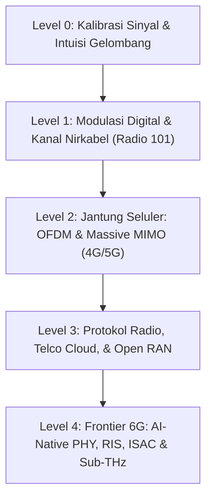

# 📡 ROAD TO 6G SYSTEMS FELLOW
> **From Software Engineer to 6G Wireless Systems Fellow — Daily Lab Grind, Sionna Simulations & Physical Layer Roadmap**

[](https://github.com/jouzu1/road-to-6g-fellow)
[](https://developer.nvidia.com/sionna)
[](https://www.3gpp.org)
[](https://pytorch.org)
[](LICENSE)

---

## 🎯 Gambaran Umum & Filosofi Kurikulum

Kurikulum ini dirancang khusus untuk menjembatani latar belakang **Teknik Elektro** dan keahlian **Software Engineering (SWE)** menuju ranah **6G Physical Layer & Telco Cloud Architecture**.

Di era 5G-Advanced dan 6G, pemrosesan sinyal radio berpindah dari kotak perangkat keras tertutup (*black-box ASICs*) ke arsitektur perangkat lunak modular berbasis GPU (*AI-Native PHY*, Open RAN, dan *differentiable link-level simulators* seperti NVIDIA Sionna).

> **💡 The "Golden Unicorn" Advantage:**  
> Insinyur telekomunikasi klasik jago menurunkan persamaan Maxwell dan propagasi gelombang, namun kerap kesulitan saat berhadapan dengan Linux kernel, Docker, Kubernetes, dan PyTorch. Sebaliknya, SWE modern piawai membangun microservices dan cloud infrastructure, namun buta terhadap representasi $I/Q$, Transformasi Fourier, dan desah termal Johnson-Nyquist.  
> **Menguasai kedua dunia ini menjadikan Anda talenta langka yang sangat dicari di era transisi 6G.**

---

## 📑 Daftar Isi (Table of Contents)

* [🗺️ Peta Jalur Pembelajaran (Learning Milestones)](#️-peta-jalur-pembelajaran-learning-milestones)
* [🧭 Peta Lapangan Kerja & Realitas Industri](#-peta-lapangan-kerja--realitas-industri)
* [💼 Taksonomi Role Engineer 6G](#-taksonomi-role-engineer-6g)
* [🔹 LEVEL 0: Kalibrasi Gelombang & Intuisi Sinyal](#-level-0-kalibrasi-gelombang--intuisi-sinyal-fondasi-tanpa-rumus-horor)
* [🔹 LEVEL 1: Modulasi Digital, Kanal Nirkabel, & Evaluasi Kinerja](#-level-1-modulasi-digital-kanal-nirkabel--evaluasi-kinerja-fisika-sinyal-terdistorsi)
* [🔹 LEVEL 2: Jantung Seluler Modern: OFDM & Massive MIMO](#-level-2-jantung-seluler-modern-ofdm--massive-mimo-4g5g-radio)
* [🔹 LEVEL 3: Tumpukan Protokol, Telco Cloud, & Open RAN](#-level-3-tumpukan-protokol-telco-cloud--open-ran-domain-swe)
* [🔹 LEVEL 4: Frontier 6G: AI-Native PHY, RIS, ISAC, & Sub-THz](#-level-4-frontier-6g-ai-native-phy-ris-isac--sub-thz-lab-riset-masa-depan)
* [🛠️ Peralatan Laboratorium Software (Tooling Stack)](#️-peralatan-laboratorium-software-tooling-stack)
* [📅 Rencana Aksi Praktis 90 Hari (The 90-Day Lab Grind)](#-rencana-aksi-praktis-90-hari-the-90-day-lab-grind)
* [🏁 Cara Belajar & Ground Rules](#-cara-belajar--ground-rules)

---

## 🗺️ Peta Jalur Pembelajaran (Learning Milestones)



```
[Level 0: Kalibrasi Gelombang & Intuisi Sinyal]
                    │
                    ▼
[Level 1: Modulasi, Bit, & Kanal Nirkabel (Radio 101)]
                    │
                    ▼
[Level 2: Jantung Seluler: OFDM & Massive MIMO (4G/5G)]
                    │
                    ▼
[Level 3: Telco Cloud, Protokol, & Open RAN (Sisi SWE)]
                    │
                    ▼
[Level 4: Frontier 6G: AI-Native PHY, Sub-THz, & RIS (Sionna)]
```

---

## 🧭 Peta Lapangan Kerja & Realitas Industri

Biar Anda punya kompas karier yang realistis dan terukur, berikut pemetaan ekosistem industri telekomunikasi saat ini:

1. **Operator Seluler Nasional (Telkomsel, Indosat Ooredoo Hutchison, XL Axiata):**  
   Bukan sekadar operasi menara BTS fisik. Terdapat divisi *Telco Cloud Architect*, *5G Core Network Specialist*, *Network Automation SWE* (CI/CD pipelines jaringan), dan *Traffic Optimization / AI-RAN Data Scientist*.
2. **Global Vendor & Silicon Giants (Peluang Remote / Regional Hub SG):**  
   NVIDIA (divisi *Telecommunications & Aerial 6G*), Qualcomm, Ericsson, Nokia, Samsung Research, AMD, Intel. Ekosistem ini sangat membutuhkan *software engineer* yang menguasai C++/CUDA/Python sekaligus paham konsep propagasi gelombang elektromagnetik.
3. **Open RAN & Next-Gen Cloud-Native Startups:**  
   Perusahaan perintis seperti Rakuten Symphony, Mavenir, dan Parallel Wireless yang membangun infrastruktur radio murni berbasis cloud (*vRAN / Cloud-RAN*).
4. **Industri Satelit & NTN (Non-Terrestrial Networks):**  
   Starlink, Amazon Project Kuiper, Telkomsat, BRIN. Fokus pada integrasi jaringan satelit orbit rendah (LEO) langsung ke smartphone standar (*Direct-to-Cell / 3GPP NTN*).

---

## 💼 Taksonomi Role Engineer 6G

Berdasarkan studi standardisasi ITU-R IMT-2030 dan transformasi industri seluler, berikut peran-peran spesialis baru yang muncul di era 6G:

| Nama Peran (*6G Job Role*) | Domain Operasional Utama | Kompetensi Teknis & Pemetaan Skill SWE |
| :--- | :--- | :--- |
| **AI-Native Air Interface & RAN Engineer** | Merancang antarmuka udara berbasis AI dan otomatisasi RAN (*zero-touch automation*). | Deep Reinforcement Learning (DRL), Federated Learning, Neural Demapper, O-RAN near-RT RIC, xApps/rApps (Python/C++). |
| **ISAC Signal Processing Specialist** | Menyatukan radar penginderaan spasial dan komunikasi data pada satu *waveform*. | Pemrosesan sinyal radar OFDM, estimasi kanal spasial, estimasi Doppler/Delay, pemetaan 3D point-cloud real-time. |
| **RIS System Optimization Engineer** | Memprogram dan merekayasa lingkungan propagasi radio pintar menggunakan metamaterial. | Rekayasa matriks fase pantulan (*phase-shift optimization*), pemodelan ray tracing 3D (`sionna.rt`), mitigasi blindspot NLOS. |
| **Sub-THz & Extreme PHY Systems Engineer** | Meneliti dan mengevaluasi kinerja link pada spektrum gelombang ekstrem (92 GHz – 300 GHz). | Pemodelan *phase noise*, kompensasi non-linearitas Power Amplifier (PA), modulasi numerologi tinggi, mitigasi serapan gas atmosfer ($O_2/H_2O$). |
| **Telco Cloud & O-RAN Platform Engineer** | Membangun infrastruktur komputasi bare-metal untuk pemrosesan sinyal PHY real-time. | Linux kernel tuning, DPDK, SR-IOV, eBPF, Kubernetes bare-metal COTS, akselerasi GPU inline (NVIDIA Aerial SDK). |
| **NTN & Satellite-Cellular Specialist** | Mengintegrasikan konstelasi satelit LEO dengan jaringan terestrial 5G/6G. | Kompensasi Doppler ekstrem kecepatan orbit (7.5 km/s), propagasi delay tinggi, handover antar-satelit beam hopping. |

---

## 🔹 LEVEL 0: Kalibrasi Gelombang & Intuisi Sinyal (Fondasi Tanpa Rumus Horor)
> **Target:** Membangun insting fisik intuitif terhadap sinyal nirkabel tanpa terjebak penurunan kalkulus yang kaku.

### 1. Waktu vs. Frekuensi (Domain Dualitas)
* **Analogi Jus Buah Fourier:** Sinyal waktu adalah segelas jus campur aneka buah; spektrum frekuensi adalah daftar resep takaran tiap buah (berapa gram apel, berapa gram wortel).
* Transformasi Fourier (FT, DFT, FFT) sebagai alat "kacamata tembus pandang" untuk melihat kepadatan energi frekuensi.
* Kenapa spektrum frekuensi (Hz, MHz, GHz) menjadi komoditas paling mahal di dunia telekomunikasi.

### 2. Baseband vs. Passband (Fisika Antena)
* Kenapa suara manusia (20 Hz – 20 kHz) tidak bisa langsung dipancarkan lewat udara tanpa modulasi frekuensi pembawa (*Carrier*):

```math
\lambda = \frac{c}{f}
```

* Hubungan panjang gelombang ($\lambda$) dengan ukuran fisik antena dipole ($\lambda / 2$ atau $\lambda / 4$):
  * Frekuensi radio AM ($1\text{ MHz}$): $\lambda = 300\text{ m} \rightarrow$ butuh tiang antena setinggi puluhan meter.
  * Frekuensi 5G Mid-Band ($3.5\text{ GHz}$): $\lambda \approx 8.5\text{ cm} \rightarrow$ ukuran elemen antena di smartphone cukup beberapa milimeter.
* Konsep Frekuensi Pembawa (*Carrier Frequency*) dan proses *Upconversion / Downconversion*.

### 3. Representasi I/Q & Bilangan Kompleks (I + jQ)
* Menghilangkan keraguan terhadap bilangan imajiner: `j` hanyalah penanda geometris rotasi 90° agar dua gelombang ortogonal (`cos` dan `sin`) dapat berbagi kabel atau antena yang sama tanpa saling meniadakan (*in-phase* vs *quadrature*).
* Hubungan matematis sinyal passband:

```math
s(t) = I(t)\cos(2\pi f_c t) - Q(t)\sin(2\pi f_c t) = \text{Re}\left[ (I(t) + jQ(t)) e^{j 2\pi f_c t} \right]
```

### 4. Batas Absolut Alam Semesta: Kapasitas Shannon-Hartley
* Persamaan fundamental kapasitas kanal radio:

```math
C = B \log_2\left(1 + \frac{S}{N}\right)
```

* Trade-off abadi antara Lebar Pita (*Bandwidth* $B$) dan Daya Sinyal terhadap Derau (*Signal-to-Noise Ratio* / SNR).
* Desah Termal Johnson-Nyquist: Kenapa di suhu ruangan (`T = 290 K`) selalu ada desah bawaan semesta:

```math
N_0 = k_B T \approx -174\text{ dBm/Hz}
```

---

## 🔹 LEVEL 1: Modulasi Digital, Kanal Nirkabel, & Evaluasi Kinerja (Fisika Sinyal Terdistorsi)
> **Target:** Memahami bagaimana deretan bit biner dikemas ke gelombang dan bagaimana badai udara mendistorsi data tersebut.

### 1. Taksonomi Modulasi Digital
* Dari nada tunggal ke konstelasi multi-bit: ASK/FSK $\rightarrow$ BPSK (1 bit/simbol) $\rightarrow$ QPSK (2 bit/simbol).
* **M-QAM (16-QAM, 64-QAM, 256-QAM, 1024-QAM):**
  * Mental model papan catur koordinat senter $I/Q$.
  * Trade-off: Semakin banyak bit per simbol, efisiensi spektral melonjak drastis, namun jarak antar titik konstelasi kian rapat dan rentan eror terhadap desah.
  * *Gray Coding:* Strategi penomoran biner agar kesalahan tebak titik terdekat hanya menghasilkan 1 bit eror.

### 2. Anatomi Kanal Nirkabel (The Hostile Air)
* **Path Loss & Shadowing:** Atenuasi daya sinyal seiring jarak ($d^{-\alpha}$) dan penghalang makro (bukit, gedung beton).
* **Multipath Fading:** Fenomena pantulan gelombang (*constructive vs destructive interference*) yang memicu lembah sinyal (*deep fade*).
* **Model Kanal Standar Industri (3GPP TR 38.901):**
  * *AWGN (Additive White Gaussian Noise):* Model dasar tanpa pantulan.
  * *Rayleigh vs Rician Fading:* Kondisi tanpa garis pandang langsung (NLOS) vs dengan garis pandang (LOS).
  * *CDL (Clustered Delay Line) & TDL (Tapped Delay Line):* Simulasi berkas pantulan kluster realistis untuk evaluasi MIMO 5G/6G.
* **Doppler Effect & Coherence Time:** Pergeseran frekuensi saat perangkat bergerak kencang (analogi suara sirine ambulans saat melintas).

### 3. Deteksi & Koreksi Eror (Channel Coding / FEC)
* Filosofi proteksi bit: Kenapa bit mentah wajib dibungkus bit redundansi (*parity*).
* Evolusi Coding: Parity $\rightarrow$ Hamming $\rightarrow$ Viterbi / Convolutional $\rightarrow$ Turbo Code (3G/4G) $\rightarrow$ **5G LDPC (Data) & Polar Codes (Control)**.
* **Log-Likelihood Ratio (LLR):** Konsep probabilitas keyakinan (*soft decision*) vs vonis biner kaku (*hard decision*).

### 4. Hands-on Milestone: Benchmarking Kinerja Link
* Simulasi Monte Carlo: Menghitung kurva **BER (Bit Error Rate) vs. SNR ($E_b/N_0$)**.
* Menentukan *Waterfall Region* dan batas kinerja modulasi klasik di kanal AWGN vs Rayleigh Fading.

---

## 🔹 LEVEL 2: Jantung Seluler Modern: OFDM & Massive MIMO (4G/5G Radio)
> **Target:** Membedah teknologi inti yang memungkinkan smartphone modern menembus kecepatan ratusan Mbps.

### 1. OFDM (Orthogonal Frequency Division Multiplexing)
* **Analogi Armada Sepeda Motor:** Daripada menyewa 1 truk monster raksasa yang gampang terjebak macet (single carrier lebar), kita sewa 1.000 sepeda motor kecil yang melaju beriringan membawa paket (subcarriers paralel berkecepatan rendah) yang kebal terhadap *frequency-selective fading*.
* Syarat matematis ortogonalitas subcarrier:

```math
\Delta f = \frac{1}{T_s}
```

* **Cyclic Prefix (CP):** Trik menyalin ekor simbol ke awal paket guna menetralkan *Inter-Symbol Interference* (ISI) akibat pantulan gedung.

### 2. Ranah Spasial: MIMO & Beamforming
* **SISO $\rightarrow$ SIMO $\rightarrow$ MISO $\rightarrow$ MIMO:**
  * *Diversity Gain:* Mengirim replika sinyal yang sama lewat banyak antena agar tahan terhadap fading.
  * *Spatial Multiplexing:* Mengirim aliran data yang berbeda di frekuensi dan waktu yang sama persis lewat antena berbeda (melipatgandakan kapasitas tanpa menambah alokasi spektrum).
* **Digital, Analog, & Hybrid Beamforming:** Mengarahkan pancaran gelombang elektromagnetik terfokus (*pencil beam*) tepat ke koordinat pengguna layaknya lampu sorot panggung.
* **Massive MIMO (32T32R, 64T64R):** Pemanfaatan teori matriks acak besar (*random matrix theory*) di mana efek interferensi antarpengguna dan noise mengecil secara asimtotik (*favorable propagation*).

### 3. Manajemen Akses Radio & Dupleks
* **FDD vs. TDD:** Pemisahan Uplink/Downlink via perbedaan frekuensi (FDD) vs perbedaan slot waktu pada frekuensi yang sama (TDD).
* Sinkronisasi ketat di TDD: Kebutuhan sinyal referensi GPS/1PPS dan protokol IEEE 1588v2 PTP untuk mencegah transmisi BTS tetangga menabrak penerimaan BTS lainnya.

---

## 🔹 LEVEL 3: Tumpukan Protokol, Telco Cloud, & Open RAN (Domain SWE)
> **Target:** Menghubungkan pemrosesan sinyal fisik dengan arsitektur jaringan software modern dan cloud-native.

### 1. Tumpukan Protokol Radio (L1 / L2 / L3)
* **PHY (Layer 1):** Modulasi, coding, FFT, estimasi kanal, dan beamforming.
* **MAC (Medium Access Control):** Penjadwalan alokasi blok sumber daya (*Physical Resource Blocks / PRB*) per subframe milidetik.
* **RLC & PDCP:** Segmentasi paket, retransmisi otomatis (ARQ / HARQ), enkripsi keamanan, dan kompresi header IP (RoHC).
* **RRC (Radio Resource Control):** Otak pensinyalan koneksi (*handover*, *cell selection*, *paging*).

### 2. 5G Core: Arsitektur Cloud-Native (SBA)
* Transformasi dari perangkat keras tertutup ke tumpukan **Microservices**:
  * Network Functions: **AMF** (Autentikasi & Mobilitas), **SMF** (Manajemen Sesi), **UPF** (Jalan Tol Paket Data), **NRF** (Service Registry & Discovery).
* Komunikasi antar Network Function menggunakan **HTTP/2 REST APIs** dengan serialisasi data **JSON** di atas enkripsi TLS.
* **CUPS (Control and User Plane Separation):** Protokol PFCP (3GPP TS 29.244) untuk mengarahkan aliran paket UPF berkecepatan 100 Gbps+.

### 3. Open RAN (O-RAN) & Virtualized RAN (vRAN)
* Memecah menara BTS monolitik menjadi 3 modul terbuka terstandarisasi:
  * **RU (Radio Unit):** Di puncak menara, mengurus RF analog, konversi DAC/ADC, dan filter frekuensi.
  * **DU (Distributed Unit):** Mengurus kalkulasi PHY real-time (FFT/Demodulasi), berjalan di server x86 komersial COTS (*Commercial Off-The-Shelf*).
  * **CU (Centralized Unit):** Mengurus layer protokol atas (PDCP/RRC) di pusat data lokal atau cloud.
* Akselerasi Perangkat Keras: Pemanfaatan DPDK (*Data Plane Development Kit*), SR-IOV, eBPF, dan akselerasi GPU/FPGA inline untuk memproses jutaan paket per detik dengan latensi deterministik sub-milidetik.

---

## 🔹 LEVEL 4: Frontier 6G: AI-Native PHY, RIS, ISAC, & Sub-THz (Lab Riset Masa Depan)
> **Target:** Menguasai ranah riset terdepan telekomunikasi masa depan sesuai standar ITU-R IMT-2030 dan 3GPP.

### 1. Kerangka Standarisasi & Roadmap Global
* **ITU-R IMT-2030 (Recommendation ITU-R M.2160):**
  * 6 Skenario Penggunaan Utama:
    1. *Immersive Communication* (IC)
    2. *Hyper-Reliable Low-Latency Communication* (HRLLC)
    3. *Massive Communication* (MC)
    4. *Ubiquitous Connectivity* (UC / Integrasi Satelit NTN LEO)
    5. *AI and Communication* (AIAC)
    6. *Integrated Sensing and Communication* (ISAC)
* **Garis Waktu Standardisasi 3GPP Menuju 6G:**
  * *Rel-18 & Rel-19 (5G-Advanced):* Pengenalan awal AI/ML untuk antarmuka radio (beam management, CSI feedback compression, positioning).
  * *Rel-20 (2025–2026):* Fase studi kelayakan resmi 6G (*6G Study Phase*).
  * *Rel-21 (2027–2028):* Spesifikasi teknis normatif pertama 6G (*Normative Specifications*).

### 2. AI-Native Physical Layer & Differentiable Link (NVIDIA Sionna)
* **Neural Demapper & Neural Receiver:** Menggantikan modul estimasi kanal tradisional (LS/MMSE) dan ekualisasi dengan *Deep Neural Networks* (ResNet / CNN / Transformer).
* **End-to-End Autoencoder Communications:** Mengoptimalkan pemancar ($TX$) dan penerima ($RX$) secara simultan melintasi kanal radio diferensiabel via *backpropagation* gradien end-to-end.

### 3. Reconfigurable Intelligent Surfaces (RIS)
* **Konsep:** Rekayasa lingkungan propagasi cerdas (*Smart Radio Environments*) menggunakan metamaterial pasif yang ditempel pada fasad gedung untuk membelokkan berkas gelombang menembus blindspot (*NLOS bypass*).
* **Formulasi Matematika Pergeseran Fase:**

```math
\mathbf{y} = \mathbf{H}_{\text{RIS} \to \text{RX}} \mathbf{\Theta} \mathbf{H}_{\text{TX} \to \text{RIS}} \mathbf{x} + \mathbf{w}
```

  di mana matriks diagonal pergeseran fase didefinisikan sebagai:

```math
\mathbf{\Theta} = \text{diag}\left(e^{j\theta_1}, e^{j\theta_2}, \dots, e^{j\theta_N}\right)
```

* **Simulasi Lingkungan 3D:** Integrasi pemodelan ray tracing 3D fisik (`sionna.rt` berbasis mesin rendering Mitsuba 3) dengan pemodelan kanal CDL.

### 4. Frekuensi Sub-Terahertz (Sub-THz: 92 GHz – 300 GHz) & FR3
* Lebar pita raksasa (puluhan GHz) untuk target *peak data rate* $\ge 100\text{ Gbps}$.
* **Tantangan Fisik Ekstrem:**
  * Penyerapan molekular gas atmosfer ($O_2$ dan molekul uap air $H_2O$).
  * Ketidaksempurnaan perangkat keras RF (*Hardware Impairments*): *Phase Noise* parah pada osilator frekuensi ultra-tinggi, non-linearitas *Power Amplifier* (PA), dan saturasi LNA.

### 5. ISAC (Integrated Sensing and Communication)
* Menyatukan fungsi radar penginderaan dan transmisi data telekomunikasi dalam satu pemancar, satu alokasi spektrum, dan satu bentuk gelombang (*dual-functional waveform*).
* Memanfaatkan pantulan gelombang komunikasi untuk mendeteksi kecepatan, jarak, dan pemetaan 3D lingkungan sekitar kendaraan otonom dan drone.

---

## 🛠️ Peralatan Laboratorium Software (Tooling Stack)

1. **Python 3.10+ & NVIDIA Sionna:** Simulasi link-level lapisan fisik berakselerasi GPU dan ray tracing 3D radio.
2. **PyTorch / TensorFlow:** Pembangunan arsitektur Neural Demapper, Neural Receiver, dan autoencoder transceiver end-to-end.
3. **Open5GS & UERANSIM:** Simulasi tumpukan 5G Standalone Core (SBA) dan emulasi Radio RAN pada Linux.
4. **Wireshark & tshark:** Analisis alur pensinyalan protokol (HTTP/2 SBA, PFCP, NGAP, RRC).
5. **MATLAB & 5G/6G Exploration Toolbox:** Verifikasi benchmark standar industri, analisis EVM, ACPR, dan numerologi gelombang ekstrem.

---

## 📅 Rencana Aksi Praktis 90 Hari (The 90-Day Lab Grind)

Tak perlu menunggu atau bingung harus mulai dari mana. Berikut rencana kerja mandiri 3 bulan untuk membangun portofolio konkret:

```
[BULAN 1: BONGKAR PROTOKOL SELULER DI LAPTOP]
Target : Memahami tumpukan jaringan dan aliran data dari perangkat pengguna ke Internet.
Action :
- Siapkan lingkungan Linux (Ubuntu 22.04 LTS / WSL2).
- Deploy Open5GS (5G Core) dan UERANSIM (gNB & UE Emulator) via Docker Compose.
- Rekam paket pensinyalan pendaftaran nomor (Registration / Attach Procedure) menggunakan Wireshark.
- Pahami interaksi AMF, SMF, dan UPF melalui kacamata HTTP/2 REST APIs dan protokol PFCP.

[BULAN 2: FISIKA GELOMBANG & AI-NATIVE PHY]
Target : Menuntaskan modul Level 0 & Level 1 serta eksperimen neural demapper.
Action :
- Pahami konsep spektrum Fourier, konstelasi I/Q, dan batas kapasitas Shannon.
- Buka Google Colab GPU, instal pustaka NVIDIA Sionna (sionna.phy).
- Bangun rantai transmisi modulasi QAM melintasi kanal AWGN dan Rayleigh Fading.
- Latih model Neural Demapper sederhana berbasis PyTorch dan bandingkan kurva BER vs SNR terhadap demapper klasik.

[BULAN 3: BANGUN PORTOFOLIO GITHUB UNIK & KONEKSI INDUSTRI]
Target : Membuktikan kompetensi lintas bidang (SWE + Telco) kepada perekrut dan komunitas global.
Action :
- Buat repositori riset publik berisi hasil eksperimen (misal: "Sionna-based Neural Receiver Benchmark over 3GPP CDL Channels").
- Tulis dokumentasi arsitektur yang tajam dan artikel teknis di LinkedIn / Medium.
- Jalin komunikasi dengan praktisi di bidang Telco Cloud, 5G Core Integration, atau RAN Automation!
```

---

## 🏁 Cara Belajar & Ground Rules

1. **Analogi Nyata Terlebih Dahulu:** Setiap topik dibuka dengan analogi dunia nyata untuk mengunci intuisi sebelum melangkah ke detail matematis.
2. **Logika Fisika & Standar Terbuka:** Mengutamakan pemahaman alur kerja dan standar terbuka (3GPP, ITU-R, O-RAN) daripada menghafal rumus.
3. **Hands-on Code First:** Setiap konsep langsung dihubungkan ke implementasi kode nyata (Python / Sionna / COTS Linux) agar keahlian *software engineering* Anda terkapitalisasi secara maksimal.

---

*“Background Teknik Elektro yang nyebrang jadi Software Engineer itu ibarat memegang dua pedang legendaris sekaligus. Jangan pernah mundur hanya karena rumit — mari kita taklukkan tumpukan teknologinya langkah demi langkah!”*
